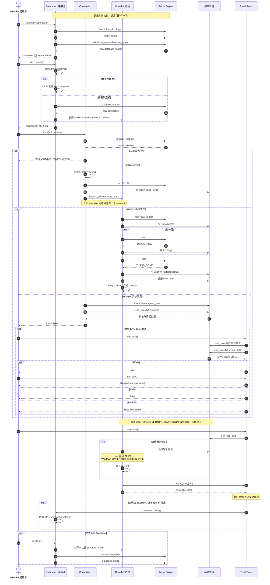

# mturso 查询生命周期

本文描述一次 `Connection::query(sql, params)` 从连接创建到结果释放的完整路径。

## 读图重点

- `fds[0]` 是管道读端，交给 MoonBit 的 `RawFdStream`；`fds[1]` 是写端，只交给 C worker。
- `query()` 返回时通常只消费了 `HEADER`。后续行通过 `rows.has_next()` 和 `rows.get_row()` 从管道继续拉取。
- worker 在独立线程中执行 Turso 的 `step` / `run_io`，不会阻塞 MoonBit 事件循环。
- 管道是有界 FIFO。结果生产得太快时，worker 会在写入端阻塞，从而限制未消费结果占用的内存。
- `rows.close()` 先关闭读端，再等待 worker 结束；这样 `stmt` 在执行线程停止后才能安全释放。
- 池化查询结束后，`Connection::close()` 将连接放回 `Database` 的 idle 列表，不销毁 worker 线程。

## 源码入口

- 连接池与 worker 生命周期：[`ffi/connection.c`](../ffi/connection.c)
- 管道创建与 job 提交：[`ffi/statement.c`](../ffi/statement.c)
- 结果帧写入：[`ffi/stream.c`](../ffi/stream.c)
- POSIX / Win32 句柄与同步抽象：[`ffi/platform.h`](../ffi/platform.h)
- `query()` 与帧读取：[`rows.mbt`](../rows.mbt)
- `Database::open` / `connect`：[`mturso.mbt`](../mturso.mbt)
