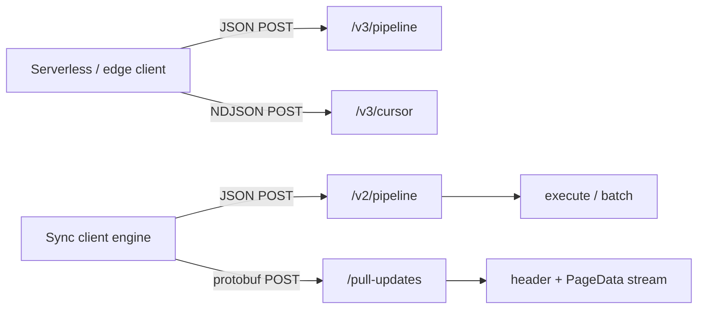

# Turso HTTP 协议参考

本文整理 Turso v0.8.2 与本项目相关的两类 HTTP 协议：

1. **SQL-over-HTTP / serverless**：用 JSON 发送 SQL，由 `/v2|v3/pipeline` 和
   `/v3/cursor` 执行。
2. **Sync HTTP**：同步引擎用 `/v2/pipeline` 执行同步状态 SQL，用
   `/pull-updates` 传输 protobuf 页面流或 MVCC logical-log。

结论先说：

- Turso 官方**有** SQL-over-HTTP 的公开文档，也有上游源码中的完整 **Version 3**
  协议规范。
- 公开文档站点主要描述旧版 `/v2/pipeline`；上游
  `serverless/PROTOCOL.md` 才完整描述 v3、cursor、stream/baton、更多 request
  types 和错误模型。[源码证据]
- Turso 官方**没有公开发布完整的 sync wire protocol 文档**。公开 docs 只讲
  client 用法和本地 server 启动方式；`/pull-updates` 的权威定义是 v0.8.2 的
  Rust protobuf 类型与 server 实现。[源码证据]
- 本文把公开文档、源码级规范和 mturso 当前实现放在一起，作为实现和兼容性
  检查清单。

证据标记：

- **实测**：本项目实际运行过客户端或 server。
- **源码证据**：由指定版本的官方源码直接定义。
- **推断**：根据多个源码事实得出的实现建议，不是官方逐字承诺。

## 官方文档与源码地址

### 公开文档

| 主题 | 地址 | 覆盖范围 |
|---|---|---|
| SQL-over-HTTP Reference | <https://docs.turso.tech/sdk/http/reference.md> | `/v2/pipeline`、Bearer auth、参数、baton、`/version`、`/health`、`/dump` |
| SQL-over-HTTP Quickstart | <https://docs.turso.tech/sdk/http/quickstart.md> | `@tursodatabase/serverless`、`@libsql/client`、raw `/v2/pipeline` 示例 |
| Sync Usage | <https://docs.turso.tech/sync/usage.md> | `push` / `pull` / `checkpoint` / `stats` 的高层行为 |
| Local Sync Server | <https://docs.turso.tech/sync/local-sync-server.md> | `tursodb --sync-server`、无 token 的本地开发模式 |
| Partial Sync | <https://docs.turso.tech/sync/partial.md> | partial sync 的 client 配置和限制 |
| Conflict Resolution | <https://docs.turso.tech/sync/conflict-resolution.md> | 多 client 的冲突与 replay 语义 |
| Checkpoint | <https://docs.turso.tech/sync/checkpoint.md> | sync database 的显式 checkpoint |

公开 docs 的 HTTP 页面没有同步描述 v3 cursor、`sequence`、`describe`、
`store_sql`、`close_sql` 和 `get_autocommit`。这些内容以上游
`serverless/PROTOCOL.md` 为准。[源码证据]

v0.8.2 的官方 `serverless/go` client 实际发送 `/v3/pipeline` 和
`/v3/cursor`；公开 Reference 页面仍以 `/v2/pipeline` 为主。实现 server
时应以目标 client 实际请求的 path 和上游 v3 规范为准，不能只按公开页面
推断。[源码证据 + 实测]

### 官方源码中的协议规范与实现

| 文件 | 地址 | 用途 |
|---|---|---|
| `serverless/PROTOCOL.md` | <https://github.com/tursodatabase/turso/blob/v0.8.2/serverless/PROTOCOL.md> | 官方 SQL-over-HTTP Version 3 完整规范 |
| `cli/sync_server.rs` | <https://github.com/tursodatabase/turso/blob/v0.8.2/cli/sync_server.rs> | 官方本地 sync server 的实际 HTTP 路由和页面协议实现 |
| `cli/sync_server.mdx` | <https://github.com/tursodatabase/turso/blob/v0.8.2/cli/sync_server.mdx> | sync server 实现要求；包含要生成的协议文档提纲，但不是已发布网页 |
| `sync/engine/src/server_proto.rs` | <https://github.com/tursodatabase/turso/blob/v0.8.2/sync/engine/src/server_proto.rs> | `/pull-updates` 和 sync 使用的 Hrana/JSON/protobuf wire types |
| `serverless/go` | <https://github.com/tursodatabase/turso/tree/v0.8.2/serverless/go> | v0.8.2 serverless Go client |
| `bindings/go` | <https://github.com/tursodatabase/turso/tree/v0.8.2/bindings/go> | v0.8.2 embedded/sync Go client |

截至本文记录时，公开站点没有 `/sync/spec` 页面；访问
<https://docs.turso.tech/sync/spec.md> 返回 404。[实测]

## 两条协议的关系

CDN/serverless SQL 与 sync client 共用 SQL-over-HTTP 的一部分 JSON 结构，
但它们的 endpoint 和用途不同。



关键区别：

| 项目 | Serverless SQL-over-HTTP | Sync HTTP |
|---|---|---|
| 主 endpoint | `/v3/pipeline`, `/v3/cursor` | `/v2/pipeline`, `/pull-updates` |
| 主编码 | JSON；cursor 为 NDJSON | pipeline 为 JSON；pull 为 length-delimited protobuf |
| 状态 | baton 标识 stream/connection | sync engine 自己持久化 revision、WAL 和 metadata |
| 大结果 | `/v3/cursor` 增量输出 | `/pull-updates` 输出页面；本地 WAL 再由 sync engine 应用 |
| 事务 | baton 跨请求保持事务 | sync 自己的 SQL batch、CDC、replay 和冲突处理 |

## SQL-over-HTTP Version 3

以下内容来自官方 `serverless/PROTOCOL.md` v0.8.2。`/v2/pipeline` 保留兼容，
但 `get_autocommit` 和 `is_autocommit` 是 v3 增补。[源码证据]

### Endpoint

| Method | Path | 用途 |
|---|---|---|
| `POST` | `/v3/pipeline` | 在 stream 上按顺序执行请求，一次性返回每个 request 的结果 |
| `POST` | `/v3/cursor` | 执行一个 batch，并用 newline-delimited JSON 流式返回 rows |
| `POST` | `/v2/pipeline` | 旧版兼容入口；行为和 v3 pipeline 基本一致 |

### HTTP 基础

请求体通常是 UTF-8 JSON。带 body 的请求应发送：

```http
Content-Type: application/json
```

生产环境认证：

```http
Authorization: Bearer <token>
```

客户自定义远端加密 key：

```http
x-turso-encryption-key: <base64-encoded-key>
```

缺少或无效 token 通常返回 `401`。未知数据库、过期 baton 和未知 endpoint
通常返回 `404`。协议规定生产部署必须使用 HTTPS，因为 token、SQL 和结果
数据本身没有额外的传输加密。[源码证据]

### Stream、baton 和 base URL

- 请求携带 `"baton": null` 或省略 baton 时，server 创建新 stream。
- stream 持有同一个数据库连接的事务状态、stored SQL 等会话状态。
- response 的 `baton` 非空时，下一个请求应使用这个最新值。
- response 的 `baton` 为 `null` 表示 stream 已关闭。
- baton 是不透明字符串，client 不得解析。
- 一个 stream 同时只允许一个请求。旧 baton、过期 baton 或未知 baton
  通常使 stream 进入不可恢复状态，打开的事务由 server 回滚。
- response 的 `base_url` 非空时，后续请求必须改发到该 URL；为 `null`
  时继续使用当前 base URL。

### Pipeline request

```json
{
  "baton": null,
  "requests": [
    {
      "type": "execute",
      "stmt": {
        "sql": "SELECT id, name FROM users WHERE id = ?",
        "args": [
          { "type": "integer", "value": "1" }
        ],
        "want_rows": true
      }
    },
    { "type": "close" }
  ]
}
```

顶层字段：

| 字段 | 类型 | 含义 |
|---|---|---|
| `baton` | `string \| null` | 上一个 response 的最新 baton |
| `requests` | `array` | 按顺序执行的 request |

### Pipeline response

```json
{
  "baton": null,
  "base_url": null,
  "results": [
    {
      "type": "ok",
      "response": {
        "type": "execute",
        "result": {
          "cols": [],
          "rows": [],
          "affected_row_count": 1,
          "last_insert_rowid": "42",
          "rows_read": 0,
          "rows_written": 1,
          "query_duration_ms": 0.3
        }
      }
    },
    {
      "type": "ok",
      "response": { "type": "close" }
    }
  ]
}
```

每个 request 都产生一个同序 result：

```json
{ "type": "ok", "response": { "type": "<request-type>", "...": "..." } }
```

或：

```json
{
  "type": "error",
  "error": {
    "message": "...",
    "code": "...",
    "extended_code": "..."
  }
}
```

单个 SQL request 失败通常仍返回 HTTP `200`，错误在 `results` 内。请求体
损坏、baton 无效、认证失败等 HTTP/协议级错误才使用非 `200`。[源码证据]

### Request types

| `type` | 主要字段 | 作用 |
|---|---|---|
| `execute` | `stmt` | 执行一条 statement |
| `batch` | `batch.steps[]` | 执行多个 statement，并支持条件 |
| `sequence` | `sql` 或 `sql_id` | 执行分号分隔的多条 SQL，遇第一个错误停止 |
| `describe` | `sql` 或 `sql_id` | 不执行 SQL，返回参数和列描述 |
| `store_sql` | `sql_id`, `sql` | 在当前 stream 保存 SQL |
| `close_sql` | `sql_id` | 删除 stored SQL |
| `get_autocommit` | 无 | 返回连接是否处于 autocommit |
| `close` | 无 | 关闭 stream；必须是 pipeline 的最后一项 |

#### `batch` conditions

| condition | 为 true 的条件 |
|---|---|
| `{ "type": "ok", "step": n }` | 第 n 步执行成功 |
| `{ "type": "error", "step": n }` | 第 n 步未成功，包括失败或 skipped |
| `{ "type": "not", "cond": c }` | c 为 false |
| `{ "type": "and", "conds": [...] }` | 全部为 true |
| `{ "type": "or", "conds": [...] }` | 至少一个为 true |
| `{ "type": "is_autocommit" }` | 当前连接没有显式事务 |

condition 只能引用**更早**的 step；引用当前或未来 step 是协议错误。
`batch` 中单步失败默认不会自动停止后续步骤，后续步骤由 condition
决定是否运行。

### Statement 和 value encoding

Statement：

```json
{
  "sql": "INSERT INTO users(name, age) VALUES (?, ?)",
  "args": [
    { "type": "text", "value": "Alice" },
    { "type": "integer", "value": "30" }
  ],
  "named_args": [],
  "want_rows": false
}
```

`args` 和 `named_args` 不能同时非空。`want_rows` 默认 true。

| 类型 | JSON 编码 |
|---|---|
| null | `{ "type": "null" }` |
| integer | `{ "type": "integer", "value": "42" }`，十进制字符串避免 64-bit 精度损失 |
| float | `{ "type": "float", "value": 1.5 }`；非有限值返回 `value: null` |
| text | `{ "type": "text", "value": "hello" }` |
| blob | `{ "type": "blob", "base64": "3q2+7w" }` |

server 输出的 blob base64 可以不带 padding；client 应接受 padded 和
unpadded 两种输入。

### Cursor / NDJSON

`POST /v3/cursor` 的 request body 是一个 `batch`：

```json
{
  "baton": null,
  "batch": {
    "steps": [
      { "stmt": { "sql": "SELECT id FROM big_table" } }
    ]
  }
}
```

response body 不是单个 JSON，而是每行一个 JSON value：

```text
{"baton":"...","base_url":null}
{"type":"step_begin","step":0,"cols":[{"name":"id","decltype":"INTEGER"}]}
{"type":"row","row":[{"type":"integer","value":"1"}]}
{"type":"row","row":[{"type":"integer","value":"2"}]}
{"type":"step_end","affected_row_count":0,"last_insert_rowid":null}
{"type":"replication_index","replication_index":null}
```

第一行固定是 cursor header，携带 baton 和 base URL。后续 entry：

| `type` | 含义 |
|---|---|
| `step_begin` | 开始某个 step，携带 `cols` |
| `row` | 当前 step 的一行 |
| `step_end` | 成功结束当前 step |
| `step_error` | 当前 step 失败，batch 可继续 |
| `error` | cursor 致命错误，后续无更多 entry |
| `replication_index` | 成功 terminator；值本身不应解释 |

cursor 的 baton 在 batch 执行前发放，所以 cursor stream 会保留，直到
关闭或超时。若 body 在 `error` 或 `replication_index` 之前结束，client
应视为 stream 致命失败。

### 错误模型

SQL 错误对象：

```json
{
  "message": "UNIQUE constraint failed: users.email",
  "code": "SQLITE_CONSTRAINT",
  "extended_code": "SQLITE_CONSTRAINT_UNIQUE"
}
```

公开协议文档中的常见 HTTP status：

| Status | 含义 |
|---|---|
| `400` | request body 或协议字段非法 |
| `401` | token 缺失或无效 |
| `403` | 数据库存在但访问被禁止 |
| `404` | endpoint/database/baton 不存在或过期 |
| `408` | timeout |
| `429` | rate limit |
| `500` | server 内部错误 |
| `503` | 暂时不可用 |

非 `200` response 至少有 `{"error":"..."}`，但 client 不应依赖完整 body
shape。带 baton 的请求收到非 `200` 时，应视为该 stream 不可继续。

## 官方本地 Sync Server 的 HTTP 面

### 路由

v0.8.2 `cli/sync_server.rs` 支持：[源码证据]

| Method | Path | 编码 | 用途 |
|---|---|---|---|
| `POST` | `/v2/pipeline` | JSON | sync engine 的 SQL、metadata、push batch |
| `POST` | `/pull-updates` | protobuf | bootstrap 和增量页面/MVCC log |
| `OPTIONS` | 任意路径 | 无 | CORS preflight |
| `POST` | `/db/{name}/v2/pipeline` | JSON | `--sync-dir` 模式下的命名数据库 |
| `POST` | `/db/{name}/pull-updates` | protobuf | 命名数据库的 pull |

官方 v0.8.2 本地 sync server **不提供** `/v3/pipeline` 或 `/v3/cursor`。
这与 `serverless/PROTOCOL.md` 的 v3 SQL-over-HTTP 是不同实现面。[源码证据]

### `/v2/pipeline`

sync server 的 pipeline 使用 `server_proto.rs` 中同一组 JSON 结构。官方
本地 server 实际处理：

- `execute`：执行一条 statement。
- `batch`：执行带 condition 的多步 SQL。

它主要用于：

- 首次 bootstrap 时读写内部 sync metadata；
- push 时提交 CDC 产生的 SQL/事务；
- 查询 `turso_sync_last_change_id` 等同步状态。

本地 server 对请求串行处理，简化并发保证。公开 docs 的 SQL-over-HTTP
参考描述的是一个更完整的 serverless/server 接口，不应假设本地 sync
server 已实现其中所有 request types。[源码证据 + 推断]

### `/pull-updates`

Request 使用 protobuf：

```proto
message PullUpdatesReqProtoBody {
  PageUpdatesEncodingReq encoding = 1; // raw=0, zstd=1
  string server_revision = 2;
  string client_revision = 3;
  uint32 long_poll_timeout_ms = 4;
  bytes server_pages_selector = 5;
  bytes client_pages = 6;
  string server_query_selector = 7;
  PullUpdatesStreamKind stream_kind = 8; // pages=0, mvcc_logical_log=1
}
```

[源码证据：`sync/engine/src/server_proto.rs`]

Response header：

```proto
message PullUpdatesRespProtoBody {
  string server_revision = 1;
  uint64 db_size = 2;
  PageSetRawEncodingProto raw_encoding = 3;
  PageSetZstdEncodingProto zstd_encoding = 4;
  PullUpdatesStreamKind stream_kind = 5;
  PullUpdatesApplyMode apply_mode = 6; // incremental=0, replace_base=1
  MvccLogicalLogMetadataProto mvcc_log = 7;
  PullUpdatesProtocol protocol = 8; // unspecified=0, pages=1, mvcc_logical=2
}
```

Page message：

```proto
message PageData {
  uint64 page_id = 1;
  bytes encoded_page = 2;
}
```

### Wire framing

HTTP body 是连续多个 protobuf **length-delimited message**。每个 message
前面的 varint 是消息长度，不是 HTTP `Content-Length`：

```text
HTTP body
├─ varint len(header)
├─ PullUpdatesRespProtoBody
├─ varint len(page 0)
├─ PageData(page_id=0, raw 4096 bytes)
├─ varint len(page 1)
├─ PageData(page_id=1, raw 4096 bytes)
└─ ...
```

页面流约定：[源码证据]

- `page_id` 是 **0-based**；本地 core 的 WAL page number 是 1-based，
  server 必须减一。
- 一个 raw page 固定 `4096` 字节。
- header 的 `db_size` 是数据库页数；client 可据此把目标文件截断到
  `db_size * 4096`。
- 成功 response 的 `Content-Type` 是 `application/protobuf`。

### Revision

revision 对 client 是不透明字符串，不能解析后做业务判断。[源码证据]

- 官方 page server 使用 WAL frame number 作为 revision 字符串。
- MVCC logical-log 使用类似 `g1:o<offset>` 的 revision。
- mturso 当前使用数据库页面内容派生出的稳定 `page-v1:<length>:<hash>`。

因此实现新 server 时应保证：

- 同一远端状态可重复得到兼容 revision；
- revision 变化表示 client 需要拉取数据；
- client revision 等于当前 revision 时可以返回空增量 response。

### Bootstrap 和增量选择

| 场景 | 官方 page server | mturso native server 当前行为 |
|---|---|---|
| 空 client，两个 revision 都空 | 返回最新 header 和所需页面 | checkpoint 后返回完整 ReplaceBase 快照 |
| client revision 等于 server revision | 返回空增量 header，无 PageData | 返回空 Incremental header，无 PageData |
| client revision 落后 | 从 WAL 选每个 page 的最新 frame | revision 不同则重新发送完整 ReplaceBase 快照 |

mturso 的行为对 bootstrap 正确，但不是增量算法；增量 pull 仍由 ticket
#21 实现。[实测 + 源码证据]

### Selectors 和 long poll

Request 中存在两类部分同步字段：

- `server_pages_selector`：RoaringBitmap 编码的 0-based page 集合。
- `server_query_selector`：按 SQL/query 选择页面的选择器。

官方 prompt 要求解析 RoaringBitmap selector，并忽略 query selector 和
`client_pages`；v0.8.2 实际 page server 会读取 `server_pages_selector`，
但没有使用 `server_query_selector`。[源码证据]

`long_poll_timeout_ms` 在 request 中表示：当 client revision 已给出而
server revision 为空时，可以等待新变化后再返回。官方本地简化 server
主要按当前 WAL 状态立即返回；Cloud 和完整协议可以长轮询。[源码证据 +
推断]

### Encoding 和 errors

- `encoding=raw(0)`：page body 是直接页面字节。
- `encoding=zstd(1)`：页集合需要 Zstd 压缩；官方 Go client 当前不支持
  解码 Zstd page stream，官方本地 server 也返回错误。
- `stream_kind=pages(0)`：普通 SQLite/Turso page stream。
- `stream_kind=mvcc_logical_log(1)`：返回 MVCC logical-log 区间。
- 未知 stream kind、未知 enum、截断 varint、截断 protobuf、非法长度都应
  返回明确的 HTTP/protocol error，不能返回半截成功流。

### MVCC logical-log

当 `stream_kind=mvcc_logical_log` 时，header 的 `mvcc_log` 包含：

```proto
message MvccLogicalLogMetadataProto {
  string format = 1; // v0.8.2 portable format: "lml3"
  bool checkpoint_transition = 2;
  repeated MvccLogicalLogRangeProto ranges = 3;
}

message MvccLogicalLogRangeProto {
  uint64 generation = 1;
  uint64 start_offset = 2;
  uint64 end_offset = 3;
  bool starts_with_header = 4;
  bytes crc_seed = 5;
}
```

header 之后是 raw logical-log 字节，不是 `PageData` 列表。client 根据
range、CRC seed、log header 和事务 frame 格式解码。mturso native server
目前不实现这一分支。[源码证据]

## mturso Native Server 当前实现

实现位置：

- [`server/sync_protocol.mbt`](../server/sync_protocol.mbt)
- [`server/native_pipeline.mbt`](../server/native_pipeline.mbt)
- [`cmd/server/native.mbt`](../cmd/server/native.mbt)

当前路由：

| Path | 状态 |
|---|---|
| `/v2/pipeline` | 已实现 execute、batch、close |
| `/v3/pipeline` | 与 v2 共用实现 |
| `/v3/cursor` | 已实现 NDJSON step/row/step_error 输出 |
| `/pull-updates` | 已实现 raw page bootstrap 子集 |

Pipeline 当前支持：

- positional args、NULL/INTEGER/REAL/TEXT/BLOB；
- `execute` 和 `batch`；
- `ok`、`error`、`not`、`and`、`or`、`is_autocommit` condition；
- `close`。

尚未实现：

- named args；
- `sequence`、`describe`、`store_sql`、`close_sql`、`get_autocommit`；
- 真正的 stream/baton 持久化；当前 baton 恒为 `null`；
- cursor 的多请求 stream 延续；
- 公网 HTTPS 和 Bearer auth。

`/pull-updates` 当前支持：[实测 + 源码证据]

- v0.8.2 官方 Go sync client 和 MoonBit sync client 的页面 bootstrap；
- file-backed database；
- checkpoint 后读取完整数据库文件；
- 稳定内容 revision；
- `raw` encoding、`pages` stream、`ReplaceBase` 首次快照；
- 相同 revision 返回空 `Incremental` header；
- server 重启后的重新 bootstrap。

当前明确不支持：

- Zstd page encoding：HTTP `400`；
- MVCC logical-log：HTTP `501`；
- 未知 stream kind：HTTP `400`；
- partial page/query selector：HTTP `501`；
- 截断 protobuf：HTTP `400`；
- `:memory:` database：HTTP `400`。

对应的下一批实现：

- [#21](https://github.com/jaredzhou/mturso/issues/21)：增量 pull。
- [#22](https://github.com/jaredzhou/mturso/issues/22)：push。
- [#23](https://github.com/jaredzhou/mturso/issues/23)：HTTPS 和鉴权的公网模式。

## 兼容性矩阵

| 协议分支 | 公开 docs | 官方 v0.8.2 sync server | mturso native server |
|---|---|---|---|
| SQL-over-HTTP v3 source spec | 源码规范 | 不用于 sync server | 部分实现 |
| `/v2/pipeline` | 有 | 有 | 有 |
| `/v3/pipeline` | 源码规范为主 | 无 | 有，功能子集 |
| `/v3/cursor` | 源码规范 | 无 | 有，功能子集 |
| `/pull-updates` page stream | 无完整 wire docs | 有 | bootstrap 子集 |
| `/pull-updates` MVCC logical | 无完整 wire docs | 有 | 无 |
| partial page selector | 无完整 wire docs | 有 | 无 |
| `/db/{name}/...` | 公开 docs 未详述 | 有 | 无 |

## 实现检查清单

新增一个兼容 v0.8.2 的 sync server 时，至少需要：

1. 明确数据库 page size 为 4096，并区分 core 的 1-based page number 与
   wire 的 0-based `page_id`。
2. `/pull-updates` request 按 protobuf 解码；response header 和每个
   `PageData` 各自 length-delimited。
3. 按 client revision 选择增量；没有变化时返回正确 header，不发送页面。
4. bootstrap 必须同时支持客户端接受的 `Incremental` 和 `ReplaceBase`
   行为选择。
5. 拒绝未知 encoding/stream kind，并明确处理截断 protobuf。
6. 生产 stream 要区分 `protocol=pages` 和 `protocol=mvcc_logical`。
7. `/v2/pipeline` 的 SQL batch 要支持 sync metadata 查询和 push 事务。
8. 公网部署必须使用 HTTPS 和鉴权；本地 loopback 开发模式不能直接暴露。
